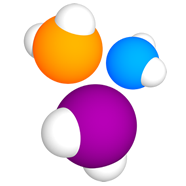
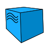

<h1 align="center">Hi there 👋, I'm <a href="https://github.com/UncleAlexx">Alexander Gai</a></h1>

QA/AQA engineer  Education  </b>
  

|IT STEP Academy  РУЧНОЕ И АВТОМАТИЗИРОВАННОЕ ТЕСТИРОВАНИЕ ПО&nbsp;&nbsp;&nbsp;&nbsp;&nbsp;&nbsp;&nbsp;&nbsp;&nbsp;&nbsp;  29.05.2026 - XX.0X.2027||
|:---|:---|

### My contacts:
&nbsp;&nbsp;&nbsp;&nbsp;
&nbsp;&nbsp;&nbsp;&nbsp;
  

### Tools:

 

  

